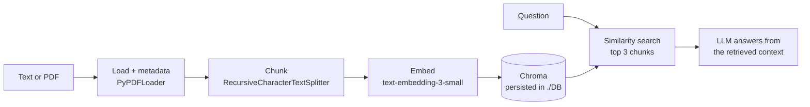

# RAG from Scratch: Hands-On Notebooks

Four notebooks that build a retrieval-augmented generation (RAG) pipeline step by step with LangChain, OpenAI embeddings and Chroma. They go from a single block of text, to PDFs, to a persistent local vector store that you can keep adding documents to.

## Notebooks

| Notebook | What it covers |
|---|---|
| `1.0_RAG_With_Own_Text.ipynb` | Wraps your own text in a LangChain `Document` with metadata, splits it with `RecursiveCharacterTextSplitter` (500 characters, 50 overlap), embeds the chunks with `text-embedding-3-small` (1,536 dimensions), stores them in Chroma and runs a top-3 similarity search |
| `2.0_RAG_PDF.ipynb` | Loads a 107-page project report with `PyPDFLoader`, replaces the default metadata with custom fields, splits it into 221 chunks (1,000 characters, 200 overlap), indexes them in an in-memory Chroma store and answers a question from the retrieved chunks with `gpt-5-nano` |
| `3.0_RAG_Local.ipynb` | Same pipeline, but persists the Chroma store to `./DB/` and reconnects to it after a kernel restart, with no re-embedding |
| `4.0_RAG_Add_Docs.ipynb` | Adds a second PDF (32 chunks) to the existing persisted store with `add_documents` and checks that the new chunks come back in search with their metadata |

`RAG_Notes.png` is a visual summary of the concepts: embeddings, why a vector database, the five-step RAG process and how chunks map to vectors in Chroma.

## The pipeline



## Concepts covered

- **Why RAG:** a model answers from your own documents at query time, without retraining it or uploading the documents to it.
- **Chunking:** choosing chunk size and overlap, and why overlap keeps sentences intact across chunk boundaries.
- **Metadata:** attaching fields like source and authors to chunks, so they come back with every search result.
- **In-memory vs persisted stores:** saving the index to disk, reconnecting to it later and adding new documents without rebuilding.

## Setup

Requires Python 3.12+, [uv](https://docs.astral.sh/uv/) and an OpenAI API key.

```bash
uv sync
```

Create a `.env` file in the project root (it's already in `.gitignore`):

```
OPENAI_API_KEY=your-key-here
```

Put your PDFs in `Docs/`, update the file paths in the notebooks, and run the notebooks in order in VS Code or Jupyter.

## Notes

- `langchain_community.vectorstores.Chroma` is deprecated. Newer code should use `from langchain_chroma import Chroma` (package `langchain-chroma`).
- `DB/` is created when you run notebook 3.0. It holds the persisted Chroma index.

## Built with

[LangChain](https://python.langchain.com/) · [Chroma](https://www.trychroma.com/) · [OpenAI embeddings](https://platform.openai.com/docs/guides/embeddings) · [pypdf](https://pypi.org/project/pypdf/)
